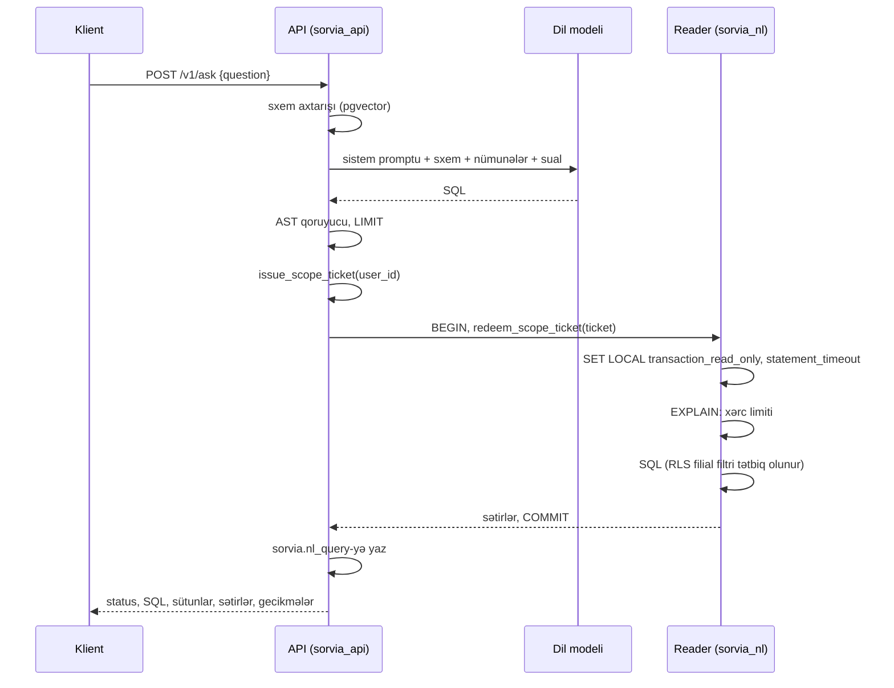

# Arxitektura

## 1. Komponentlər

| Komponent | Məsuliyyət | Kod |
|---|---|---|
| Semantik qat | Cədvəl və sütunların Azərbaycan dilində təsviri `COMMENT ON` kimi bazanın kataloqunda saxlanır. İndeksator bu təsvirləri, sütun tiplərini, açarları və az sayda nümunə dəyəri toplayıb embedding-ə çevirir | `V007__semantic_layer.sql`, `nl2sql/schema_index.py` |
| Sxem axtarışı | Sual embedding-i ilə `sorvia.schema_doc` arasında kosinus məsafəsi (`<=>`, pgvector). Ən yaxşı k obyekt götürülür, sonra ilk iki cədvəlin FK qonşuları əlavə olunur | `nl2sql/retriever.py` |
| Prompt | Sistem qaydaları, seçilmiş sxem, oxşar few-shot nümunələr, bugünkü tarix | `nl2sql/prompt.py`, `nl2sql/examples.py` |
| Dil modeli | OpenAI-uyğun istənilən endpoint (hosted API, vLLM, lokal Ollama) və ya oflayn `static` oracle | `nl2sql/llm.py` |
| Qat 1: AST qoruyucu | Yalnız bir SELECT, icazəli sxem, cədvəl və funksiyalar; LIMIT məcburi əlavə olunur | `guard/sql_guard.py` |
| Qat 2: plan xərci | `EXPLAIN` ilə optimizatorun təxmini xərci limitdən böyükdürsə, sorğu icra olunmur | `executor.py` |
| Qat 3: baza | `sorvia_reader` rolu, read-only tranzaksiya, `statement_timeout`, RLS, sütun icazələri | `executor.py`, `V006__security.sql` |
| Təmir (repair) | DB xətası (məsələn olmayan sütun) modelə qaytarılır və bir dəfə düzəliş istənir | `nl2sql/pipeline.py` |
| Jurnal | Hər sual, SQL, status, səbəb, gecikmələr `sorvia.nl_query`-də saxlanır | `nl2sql/pipeline.py` |
| İndeks məsləhətçisi | Jurnaldakı iş yükü, plan əsaslı namizədlər, HypoPG ilə what-if, tamah seçimi | `advisor/index_advisor.py` |

## 2. Bir sualın yolu

## 3. Üç verilənlər bazası identifikasiyası

| Rol | Login | Nə edə bilir | Nə edə bilmir |
|---|---|---|---|
| sxem sahibi | `postgres` (və ya `SORVIA_ADMIN_DSN`) | miqrasiya, seed, indeks yaratmaq | API tərəfindən istifadə olunmur |
| `sorvia_app` | `sorvia_api` | platforma cədvəlləri, satış və köçürmə prosedurları, ticket vermək | sxemi dəyişmək, RLS-i söndürmək |
| `sorvia_reader` | `sorvia_nl` | domen cədvəllərini oxumaq (RLS ilə), ticket-i istifadə etmək | yazmaq, `sorvia.*` və `audit.*` cədvəllərini oxumaq, FİN sütunları |

Bu ayrılıq "ən az səlahiyyət" prinsipinin tətbiqidir: modelin yazdığı SQL heç vaxt yazma icazəsi olan identifikasiya ilə icra olunmur.

## 4. Konfiqurasiya

Bütün parametrlər `SORVIA_` prefiksli mühit dəyişənləridir (`src/sorvia/config.py`, nümunə `.env.example`). `SORVIA_ENVIRONMENT=production` olduqda tətbiq zəif JWT açarı və ya default FİN açarı ilə işə düşməkdən imtina edir.

## 5. Miqyaslama qeydləri

- API stateless-dir; sürət limiti hazırda proses daxilindədir. Bir neçə instans üçün Redis kimi ortaq saxlanc lazımdır.
- `sorvia_reader` üçün ayrıca connection pool var, ona görə uzun analitik sorğular satış əməliyyatlarını gözlətmir.
- Analitik sorğular üçün `analytics` sxemi read replica-ya köçürülə bilər; RLS siyasətləri replica-da da işləyir.
