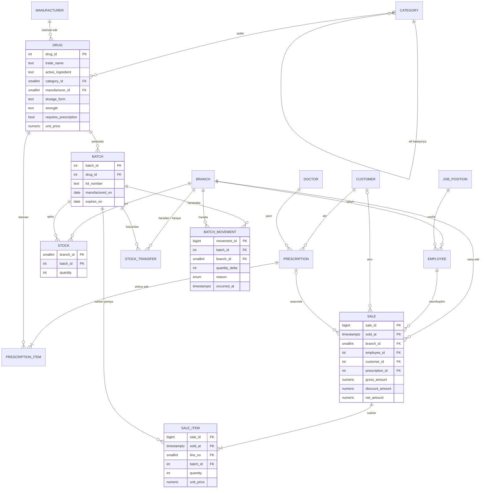

# Verilənlər bazasının layihələndirilməsi

## 1. Sahə (domen)

ŞəfaNet 7 şəhərdə 20 filialı olan aptek şəbəkəsidir (sintetik data). Sistem dərmanların istehsalçıdan müştəriyə qədər hərəkətini izləyir: partiyanın daxil olması, filiallar arası köçürmə, reseptlə və ya reseptsiz satış, vaxtı keçmiş məhsulun silinməsi.

## 2. ER diaqramı (OLTP, `pharma` sxemi)



`sorvia` sxemi (platforma): `app_user`, `scope_ticket`, `session_scope`, `schema_doc`, `nl_query`, `query_feedback`, `index_recommendation`. `audit.change_log` dəyişiklik tarixçəsini saxlayır.

## 3. Normallaşdırma

### Başlanğıc: bir böyük "satış qəbzi" cədvəli

Kağız çekdə olan hər şeyi bir cədvələ yazsaq:

```
QEBZ(qebz_no, tarix, filial_kodu, filial_adi, filial_seheri, isci_adi,
     musteri_fin, musteri_adi, [derman_adi, forma, doza, istehsalci, olke,
     kateqoriya, lot, son_tarix, miqdar, qiymet]*)
```

**1NF pozuntusu:** kvadrat mötərizədəki qrup təkrarlanır (bir çekdə bir neçə dərman). Təkrarlanan qrup ayrıca sətirlərə çıxarılır, açar `(qebz_no, setir_no)` olur.

### Funksional asılılıqlar

```
qebz_no            -> tarix, filial_kodu, isci_id, musteri_fin
filial_kodu        -> filial_adi, filial_seheri
musteri_fin        -> musteri_adi
(qebz_no, setir_no)-> lot, miqdar, qiymet
lot                -> derman_id, son_tarix
derman_id          -> derman_adi, forma, doza, istehsalci, kateqoriya
istehsalci         -> olke
```

**2NF:** `(qebz_no, setir_no)` açarlı cədvəldə `tarix`, `filial_kodu` yalnız `qebz_no`-dan asılıdır (qismən asılılıq). Ayrılır: `SALE(sale_id, ...)` və `SALE_ITEM(sale_id, line_no, ...)`.

**3NF:** `filial_kodu -> filial_adi`, `lot -> derman_id -> derman_adi`, `istehsalci -> olke` keçid (transitiv) asılılıqlarıdır. Ayrılır: `BRANCH`, `BATCH`, `DRUG`, `MANUFACTURER`, `CATEGORY`.

**BCNF:** Hər determinant namizəd açardır. Məsələn `BATCH`-da `(drug_id, lot_number)` alternativ açardır və `UNIQUE` ilə qorunur; `batch_id` süni açardır. `STOCK(branch_id, batch_id) -> quantity` tək asılılıqdır.

### Şüurlu istisnalar

| Yer | Niyə | Bütövlük necə qorunur |
|---|---|---|
| `sale.gross_amount` | Hər hesabatda sətirləri cəmləməmək üçün törəmə dəyər | Yalnız `sale_item_apply` trigger-i yeniləyir; test cəmin sətirlərə bərabər olduğunu yoxlayır |
| `sale.net_amount` | `gross - discount` | `GENERATED ALWAYS AS ... STORED`, əl ilə yazmaq mümkün deyil |
| `sale_item.sold_at` | Bölünmüş (partitioned) `sale` cədvəlinə FK üçün açarın hissəsi olmalıdır | Kompozit FK `(sale_id, sold_at)` |
| `analytics` sxemi | OLAP üçün denormallaşdırılmış ulduz sxemi | ETL yalnız OLTP-dən oxuyur; inteqrasiya testi cəmlərin üst-üstə düşdüyünü yoxlayır |

## 4. Bütövlük qaydaları

| Qayda | Mexanizm | Xəta kodu |
|---|---|---|
| Vaxtı keçmiş partiya satıla bilməz | `BEFORE INSERT` trigger, Bakı vaxtı ilə tarix | `SV001` |
| Reseptli dərman yalnız həmin müştərinin etibarlı və kifayət qədər miqdarı olan resepti ilə satılır | `BEFORE INSERT` trigger, `prescription_item.dispensed_quantity` artırılır | `SV002` |
| Qalıq mənfiyə düşə bilməz | Şərtli atomik `UPDATE ... WHERE quantity >= n` | `SV003` |
| Satışı yalnız həmin filialın aktiv işçisi edə bilər | Prosedur yoxlaması | `SV004` |
| Satış sətirləri və hərəkət jurnalı dəyişdirilə bilməz | `BEFORE UPDATE/DELETE` trigger | `SV005` |
| Qiymət, maaş, şəxsi məlumat dəyişiklikləri izlənir | `audit.log_change()`, FİN sütunları jurnaldan çıxarılır | |

## 5. Tranzaksiyalar və eyni vaxtda giriş

- `pharma.register_sale` partiyaları FEFO qaydası ilə seçir və onları `FOR UPDATE OF st` ilə həmişə eyni sırada (son tarix, sonra `batch_id`) kilidləyir. Eyni dərmanı satan iki kassa bir-birini gözləyir, deadlock yaranmır.
- `stock_transfer_apply` iki filialın qalıq sətirlərini `branch_id` artan sırası ilə kilidləyir; əks istiqamətli iki köçürmə deadlock-a düşmür.
- Read-modify-write əvəzinə atomik şərtli `UPDATE` seçilməsinin səbəbi eksperimentlə göstərilib (S2, `docs/experiments.md`).

## 6. Fiziki dizayn

| İndeks | Tip | Səbəb |
|---|---|---|
| `sale (branch_id, sold_at)` | B-tree, hər partition-da | Filial və dövr üzrə hesabatlar |
| `sale (customer_id) WHERE customer_id IS NOT NULL` | partial | Anonim satışlar (təxminən yarısı) indeksə düşmür |
| `batch (drug_id, expires_on)` | composite | FEFO seçimi bu sıra ilə gedir |
| `batch_movement (occurred_at)` | BRIN | Yalnız əlavə olunan, zamanla sıralı jurnal; S1-də BRIN B-tree-dən təxminən 900 dəfə kiçik çıxıb |
| `batch_movement (batch_id, occurred_at)` | composite | `batch_location_at` |

**Partitioning:** `pharma.sale` aylara görə bölünüb (`ensure_sale_partitions`). Köhnə ayları arxivləmək `DETACH PARTITION` ilə ani əməliyyatdır. S3 eksperimenti göstərir ki, 50 000 sətirdə bölmənin planlaşdırma xərci qazancdan böyükdür; bu, partitioning-in yalnız böyük həcmdə özünü doğrultduğunu göstərən nəticədir.

## 7. Temporal izlənmə

`batch_movement` dəyişməz jurnaldır (yalnız `INSERT`). İstənilən an üçün partiyanın yeri onun hərəkətlərinin cəmidir:

```sql
SELECT * FROM pharma.batch_location_at(42, timestamptz '2026-03-01 12:00+04');
```

Seed generatoru və inteqrasiya testi `stock` cədvəlinin hər `(filial, partiya)` cütü üçün jurnalın cəminə bərabər olduğunu yoxlayır.
